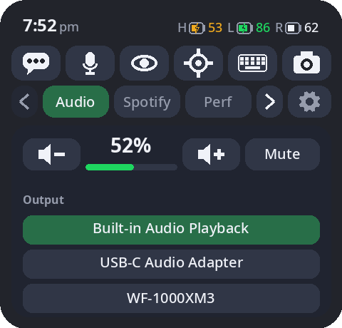
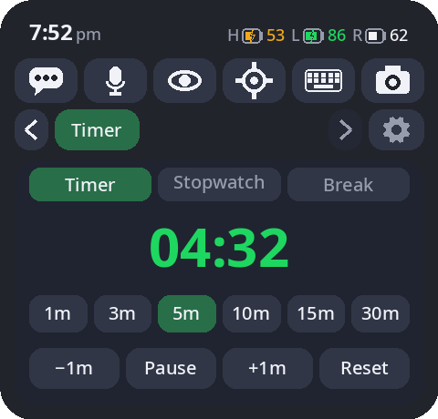
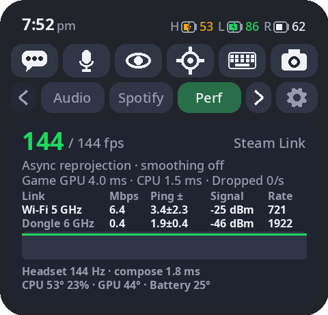
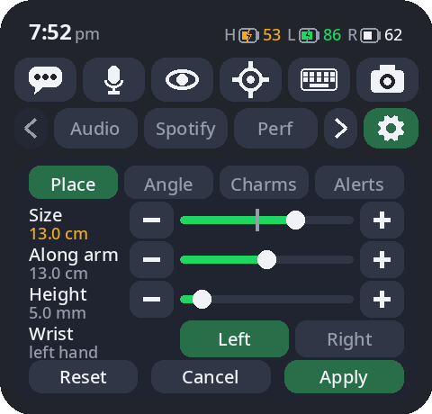
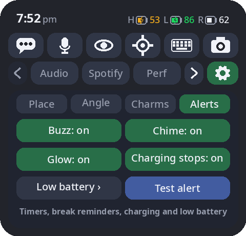
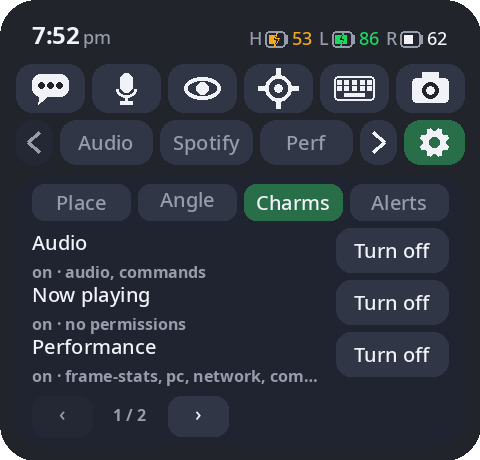

# Cuff

https://github.com/user-attachments/assets/3720c162-1180-4066-a776-92c29a05ed10

A wrist panel for the Steam Frame: glance at the back of your wrist in VR and it's there. The top
two rows are always the same, the time and battery statuses, then six quick actions; below them,
each **charm** adds a tab.

MIT licensed (`LICENSE`).

## What you get

- **Status bar:** the time, and the headset, controller and any Bluetooth headphone batteries,
  including whether a battery pack is keeping up. AirPods need LibrePods: see
  [AirPods battery](docs/AIRPODS.md).
- **Quick actions:** dictation (talk, and the text is typed into the selected dialogue box; Steam's
  on-screen keyboard gets a mic key for it too, as the panel hides while that keyboard is open), mic mute,
  passthrough, recenter, record (a clip, or a recording, with the Record charm), and a
  screenshot (on a three second countdown). Choose which six show, and in what order, in
  Settings > Quick; charms can offer more, such as Now Playing's play/pause.
- **Tabs:**
  - **Now Playing**: what's playing and its controls, from any media player (whatever is
    playing comes first). It becomes **Spotify** while the headset is your Spotify speaker (Soloist API key required).
  - **Audio**: volume, mute, and which output sound goes to.
  - **Timer**: a countdown, a stopwatch, and (if you want one) a reminder to take a break.
  - **Performance**: how a game is running. While streaming from a PC over Steam Link it
    shows the game's framerate and the state of both links (Wi-Fi and the dongle, Cuff for PC required).
  - **Record**: save a clip of the last few seconds, start and stop a recording, and watch
    them in the headset. See [Recording](docs/RECORDING.md).
  - **Settings** (the gear): where the panel sits on your wrist, which charms run, and how
    alerts get your attention.
- **Alerts:** a timer going off, a break reminder, the headset no longer charging (because your external battery pack went flat), or a
  low battery. Each one shows a message above the panel, buzzes your wrist and plays a chime.
  If the panel isn't in view, a glow appears just beyond and above the controller on that wrist
  until you look.

Touch the panel with the small sphere in front of your other controller.

| Audio | Timer | Performance |
| --- | --- | --- |
|  |  |  |

| Settings: Place | Settings: Alerts | Settings: Charms |
| --- | --- | --- |
|  |  |  |

## Install

Cuff comes in two parts. Install both: the headset app, and **Cuff for PC**.

### On the headset

In Desktop Mode, open Konsole and run:

```sh
curl -fsSL https://raw.githubusercontent.com/Brobert-in-aus/cuff/main/get-cuff.sh | sh
```

This installs Cuff for your user (`~/.local/share/cuff`) and starts it with SteamVR from
then on. It also downloads the on-headset speech model (about 650 MB) used for dictation
away from your PC.

Then it asks about the optional parts, for the Record tab:

- **The recorder.** It builds on the headset in a few minutes, installing Rust for you if
  needed.
- **The panel helper,** which lets recordings read the panels themselves. It asks for your
  password once.
- **mpv,** to watch recordings in the headset.

To choose up front, add options: `... | sh -s -- --all`, or `--only-cuff`, `--recorder`,
`--helper` or `--player`.

- **Update:** run it again. It installs the latest release, and rebuilds the recorder if
  that changed.
- **See what's installed:** `--status`.
- **Remove it:** `--uninstall`. Settings and videos stay; add `--purge` for settings too.

Cuff keeps a copy of its installer, so these also work without downloading it again:
`sh ~/.local/share/cuff/app/install.sh --here --status` (or `--uninstall`).

### On your PC (Windows)

Cuff for PC is a desktop app that runs at logon, in the tray. It handles dictation on your
GPU and reports the game's side of a Steam Link stream to the Performance tab. Its window
can also:

- install and update Cuff on the headset over your network;
- download your clips, recordings and screenshots, by hand or automatically;
- change all of Cuff's settings with a mouse and keyboard;
- type on the headset from the PC keyboard, or send it the clipboard (Ctrl+Alt+V);
- show how good the connection is, over the dongle and your network, and while streaming.

To set it up:

1. Download `CuffForPC-Setup-<version>.exe` from the
   [latest release](https://github.com/Brobert-in-aus/cuff/releases/latest) and run it. It installs
   for your user, asks for admin once to add its firewall rules, then starts the app. The
   first run downloads what dictation needs (about 2.5 GB), with a progress window.
2. In **Headset setup**, connect to the headset and click **Install**. This installs Cuff and
   pairs it with the PC. The page explains turning on the headset's SSH the first time.

Cuff for PC checks for a newer release once a day; **Update** on its Overview page installs
it. To run it from a copy of this repo instead, install [uv](https://docs.astral.sh/uv/) and
run `powershell -ExecutionPolicy Bypass -File pc-server\install.ps1`.

Open it later from the Start menu (**Cuff for PC**) or the tray icon. See
[docs/PC-APP.md](docs/PC-APP.md) for what each page does. Pairing by code (the
4-digit code on the wrist) is on the Overview page, or `pc-server\pair.ps1`.
Dictation on the PC is fastest with an NVIDIA GPU. On other GPUs it falls back to the CPU,
which still works but is slower.

### Without your PC

Away from home, or with the PC off, Cuff works as usual. Dictation uses the headset's own
model, and the fields only the PC can fill say so.

## Settings

The gear tab:

- **Place / Angle:** which wrist it's on (the **Wrist** row: Left or Right), size, distance
  along the arm, height off the wrist, and the panel's angles. Changes show as a blue preview where the panel will
  go, and take effect when you press **Apply**. On the right wrist, you touch it with the left
  controller.
- **Charms:** turn charms on or off, and approve ones that ask for more access (changing
  audio routing, running programs).
- **Alerts:** switch the buzz, chime, glow and charging alert on or off, and set each
  device's low battery levels.
- **Quick:** which six buttons the quick row shows, and in what order.

The same settings, plus Record's settings and the tab order, are on Cuff
for PC's **Cuff settings** page. Everything else lives in `~/.config/cuff/config.toml`, which
is optional. See `cuff/config.py` for the options.

## Privacy and security

- **Pairing:** Cuff for PC answers only a paired headset. Pairing needs a code you type on
  the PC itself, or the headset's SSH login.
- **SSH:** Cuff for PC reaches the headset with a key of its own. Your headset password is
  used once to add that key, and is never stored. Its window answers only the PC itself.
- **Firewall:** it listens on TCP 8765 on your home network, and on the Frame's dongle link
  only for the dongle's own subnet.
- **Data:** nothing leaves your network. Dictation runs on your PC or headset, and Cuff
  sends no telemetry.
- **Charms** are Python running inside Cuff: install only the ones you trust. The ones with
  powerful permissions stay off until you approve them.

## Logs

- **Headset:** `journalctl --user -u cuff -f`.
- **PC:** `%LOCALAPPDATA%\cuff-pc\server.log`.

## More

- [Writing charms](docs/CHARMS.md): the charm API, widgets, permissions and settings.
- [How Cuff works](docs/INTERNALS.md): the overlay, touch, passthrough, overlay depth,
  dictation and the bundled charms in detail.
- [Recording](docs/RECORDING.md), [AirPods battery](docs/AIRPODS.md) and
  [Spotify on the headset](docs/SPOTIFY.md): setting up the extras.
- [Roadmap](docs/ROADMAP.md): what's planned next.
