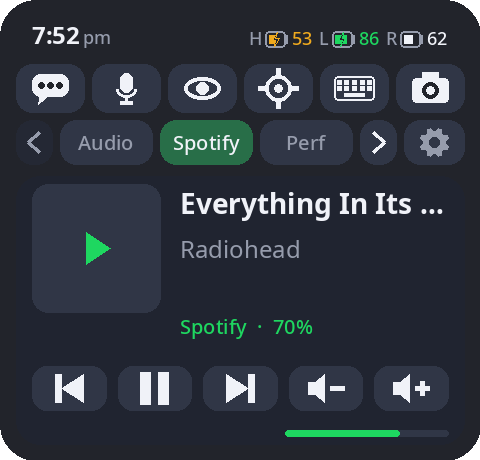
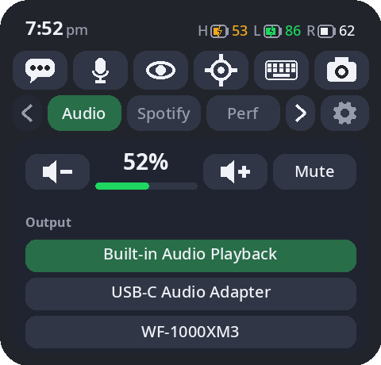
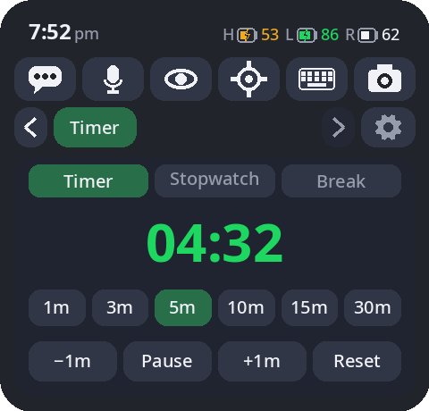
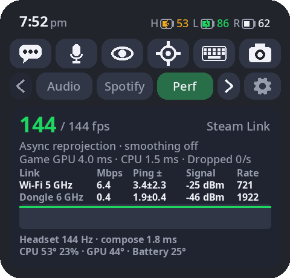
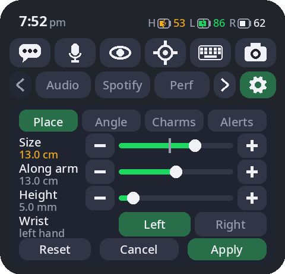
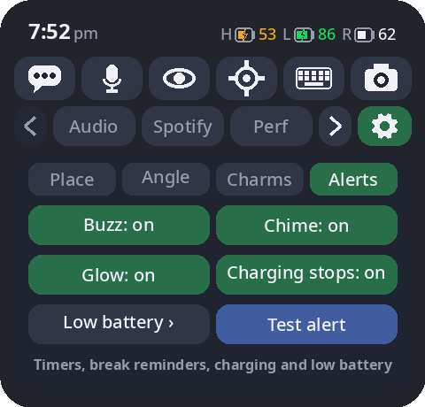
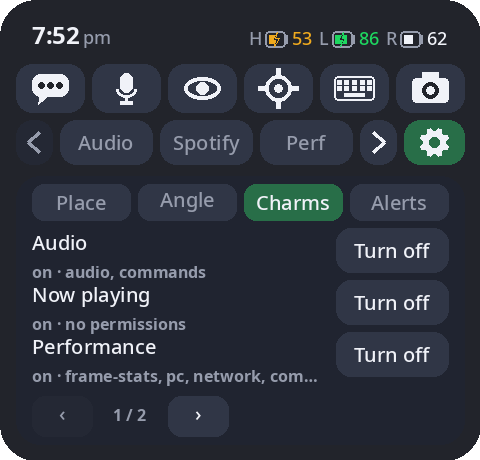

# Cuff



A wrist panel for the Steam Frame: glance at the back of your wrist in VR and it's there. The top
two rows are always the same, the time and battery statuses, then six quick actions; below them,
each **charm** adds a tab.

MIT licensed (`LICENSE`).

## What you get

- **Status bar:** the time, and the headset, controller and any Bluetooth headphone batteries,
  including whether a battery pack is keeping up. AirPods need LibrePods: see
  [AirPods battery](docs/AIRPODS.md).
- **Quick actions:** dictation (talk, and the text is typed into the selected dialogue box), mic mute,
  passthrough, recenter, the SteamVR keyboard, and a screenshot (on a three second countdown).
- **Tabs:**
  - **Now Playing**: what's playing and its controls, from any media player (whatever is
    playing comes first). It becomes **Spotify** while the headset is your Spotify speaker (Soloist API key required).
  - **Audio**: volume, mute, and which output sound goes to.
  - **Timer**: a countdown, a stopwatch, and (if you want one) a reminder to take a break.
  - **Performance**: how a game is running. While streaming from a PC over Steam Link it
    shows the game's framerate and the state of both links (Wi-Fi and the dongle, Cuff for PC required).
  - **Settings** (the gear): where the panel sits on your wrist, which charms run, and how
    alerts get your attention.
- **Alerts:** a timer going off, a break reminder, the headset no longer charging (because your external battery pack went flat), or a
  low battery. Each one shows a message above the panel, buzzes your wrist and plays a chime.
  If the panel isn't in view, a glow appears just behind the controller on that wrist until you look.

Touch the panel with the small sphere in front of your other controller.

| Audio | Timer | Performance |
| --- | --- | --- |
|  |  |  |

| Settings: Place | Settings: Alerts | Settings: Charms |
| --- | --- | --- |
|  |  |  |

These are renders with sample content (`python -m cuff render`), not screenshots.

## Install

Cuff comes in two parts. Install both: the headset app, and **Cuff for PC**.

### On the headset

In Desktop Mode, open Konsole and run:

```sh
curl -fsSL https://raw.githubusercontent.com/Brobert-in-aus/cuff/main/get-cuff.sh | sh
```

This installs Cuff for your user (`~/.local/share/cuff`) and starts it with SteamVR from
then on. It also downloads the on-headset speech model (about 650 MB) used for dictation
away from your PC. To update, run it again. The uninstall command is at the top of
`install.sh`.

### On your PC (Windows)

Cuff for PC runs at logon. It handles dictation on your GPU, and reports the game's side of
a Steam Link stream to the Performance tab.

1. Install [uv](https://docs.astral.sh/uv/): `winget install --id=astral-sh.uv -e`.
2. Get this repo (download it as a zip, or `git clone`), then run:
   `powershell -ExecutionPolicy Bypass -File pc-server\install.ps1`.
   It asks for admin once to add its firewall rules, starts the app, and then pairs your
   headset: put the headset on, and type the 4-digit code your wrist shows into the **Pair
   with Cuff** window that opens on the PC.

To pair again later (a new headset, or after removing one), run `pc-server\pair.ps1`.
Dictation on the PC is fastest with an NVIDIA GPU. On other GPUs it falls back to the CPU,
which still works but is slower.

### Without your PC

Away from home, or with the PC off, Cuff works as usual. Dictation uses the headset's own
model, and the fields only the PC can fill say so.

## Settings

The gear tab:

- **Place / Angle:** which wrist it's on (the **Wrist** row: Left or Right), size, distance
  along the arm, height off the wrist, and the panel's angles. Changes show as a blue preview where the panel will
  go, and take effect when you press **Apply**. On the right wrist, you touch it with the left
  controller.
- **Charms:** turn charms on or off, and approve ones that ask for more access (changing
  audio routing, running programs).
- **Alerts:** switch the buzz, chime, glow and charging alert on or off, and set each
  device's low battery levels.

Everything else lives in `~/.config/cuff/config.toml`, which is optional. See
`cuff/config.py` for the options.

## Privacy and security

- **Pairing:** Cuff for PC answers only a paired headset. Pairing needs a code you type on
  the PC itself.
- **Firewall:** it listens on TCP 8765 on your home network, and on the Frame's dongle link
  only for the dongle's own subnet.
- **Data:** nothing leaves your network. Dictation runs on your PC or headset, and Cuff
  sends no telemetry.
- **Charms** are Python running inside Cuff: install only the ones you trust. The ones with
  powerful permissions stay off until you approve them.

## Logs

- **Headset:** `journalctl --user -u cuff -f`.
- **PC:** `%LOCALAPPDATA%\cuff-pc\server.log`.

## More

- [Writing charms](docs/CHARMS.md): the charm API, widgets, permissions and settings.
- [How Cuff works](docs/INTERNALS.md): the overlay, touch, passthrough, overlay depth,
  dictation and the bundled charms in detail.
- [Roadmap](docs/ROADMAP.md): what's planned next.
